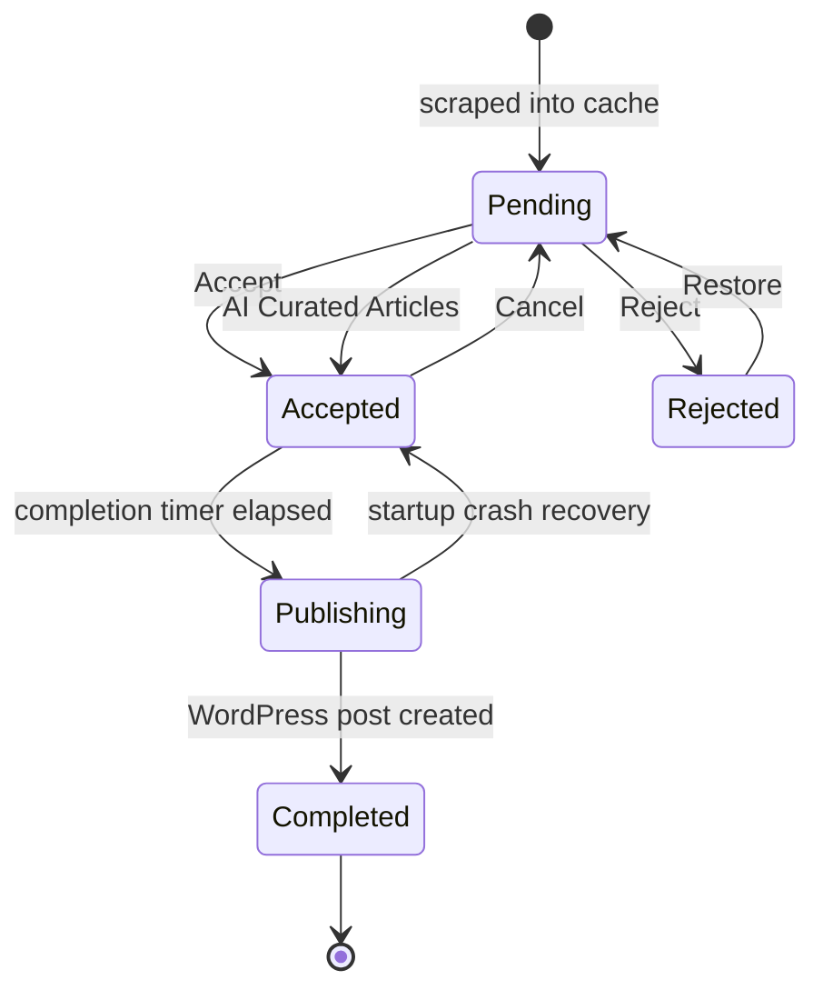
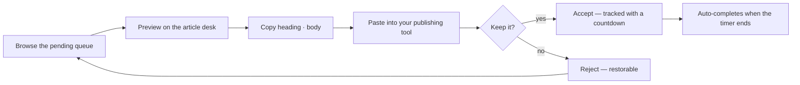

<p align="center">
  
</p>

<p align="center">
  
  
  
  
  
  
  
</p>

---

## ✨ What is News Flow?

**News Flow** is a self-hosted newsroom desk for Malayalam news. It scrapes your configured sources into a cached feed, and then hands the feed to whoever — or whatever — you want running the desk:

- 🤖 **The agent.** With a Gemini API key, an *AI Publish* curator periodically reads the pending queue, picks the most newsworthy stories, avoids duplicating anything recently accepted, and feeds them through the same pipeline as a human click. At publish time a second Gemini call files each article under the site's own WordPress categories. Completed articles are pushed to WordPress — featured image, formatted body, categories and all — automatically.
- 🖱️ **The human.** Without any AI credentials, News Flow is still a complete curation tool: a review workspace with a countdown queue, plus an article desk where the heading and full body are one click away from your clipboard — copy the heading, copy the article, paste it into whatever you publish with, and right-click the cover to copy the image.
- 🗞️ **The print edition.** The daily reset keeps yesterday's accepted stories in a separate `/publication` workspace, where the paper is laid out page by page — drag a card's image onto a page, reorder the entries, watch each page's word quota, mark what ran in print — and the finished layout exports as JSON for the bundled InDesign script.

Both modes run side by side. A human operator can pair-publish with the agent all day: you accept what it missed, it accepts while you're away, and every article — picked by hand or by model — takes the exact same path to the queue, the timer, and (if publishing is on) WordPress.

### The life of an article



Only the head of the accepted queue runs its completion timer; articles queued behind it show **Waiting** until their turn. Accepted articles are never trimmed out of the cache — only untouched pending rows past the per-source cap are pruned.

---

## 🤖 The agentic layer

Two Gemini-powered features share one client (`app/gemini.py`), and both are hardened the same way: structured JSON output via response schemas, case-insensitive matching of the model's answer against **only** real IDs from your database, retries with backoff on 429/5xx, and fail-soft everywhere — an API error never takes the pipeline down.

### AI Publish — the curator

On a configurable interval (default: hourly), pending articles are offered to Gemini as a numbered list, along with the most recently accepted headings so the same story arriving from three sources gets picked once. The model returns up to *N* article IDs; each returned ID is matched back against the list that was offered, so a hallucinated ID can never accept a real article. Picked articles are accepted through the exact same status transition as the UI's button, then enriched and published like any other.

The UI shows a live countdown meter to the next prompt, and the settings modal exposes the knobs:

| Knob | Default | Meaning |
|------|---------|---------|
| Articles per prompt | `3` | How many articles Gemini picks each round |
| Prompt interval | `60 min` | Rest between rounds (floored at 30 s) |
| Duplicate-avoidance context | `10` | Recent accepted headings shown to the model |

### AI auto-categorization — the filing clerk

WordPress categories and tags are synced into the local database at startup and refreshed on a 24 h TTL, so Gemini always classifies against the *site's current* vocabulary. Right before an article is published, its heading, description and a trimmed body (360 chars) plus the synced category list go to Gemini; the response names are matched back to real WordPress category IDs and stamped onto the article. Tags feed the model as topic context — only categories are ever applied. When Gemini returns nothing, the post falls back to the default `WORDPRESS_CATEGORY_ID` (or the site default).

### Auto publishing — the press

Completed articles go out over the WordPress REST API with an application password: the downloaded cover is uploaded to `/wp-json/wp/v2/media` and attached as the featured image, the scraped body is escaped into `<p>` paragraphs, and the post is created with `status: publish`. Every step is fail-soft — a failed upload still publishes the post without an image, and a failed post still completes the article, with the reason recorded in the notification journal.

If the server dies mid-publish, startup recovery requeues any article left in `publishing`, so nothing is orphaned or double-posted.

---

## ✍️ Manual mode — publishing without AI

No API keys? News Flow is deliberately a complete tool without them. AI toggles simply show **Unavailable** in the settings modal until their environment variables exist, and the rest of the desk works as-is.

### The article desk

Every article has a dedicated page at `/article/{id}` — the **Preview** button on any curation card, and the card's heading on `/publication` (where Preview itself is the outward link to the source). It's built for keyboard-and-clipboard operators:

| Zone | Click to copy |
|------|---------------|
| 📰 Heading | The scraped headline, clean and newline-free |
| 📄 Article body | The full scraped text, ready for your editor |

The cover image has no click handler: right-click → **Copy image** does the same job in every browser (writing image blobs through the async Clipboard API was rejected often enough to be worth dropping).

Each click shows a toast confirmation; the **Read original article** link keeps the source one tab away for attribution. When a cover or body couldn't be scraped (some pages fight back), the desk says so instead of showing empty boxes.

### The manual loop



Accepting starts the article's completion countdown and locks in its place in the queue; rejecting parks it in a collapsible list you can restore from. With `auto_publish` off, completion is just bookkeeping — nothing leaves your machine.

---

## 🧭 The review workspace

A two-pane desk served at `/`:

- **Left** — the pending feed with per-source filter tabs and three switchable layouts: **grid** (cards), **rows** (thumbnail rows), and **compact** (dense list).
- **Right** — the working queue: accepted articles with live countdown meters, collapsible **Completed** and **Rejected** lists, one-click restore.
- **Top** — a notification bell with an unread badge (a persistent journal of every background event: refresh results, AI picks, Gemini hiccups, publish failures) and a settings modal that knows which features are actually available in your environment.

A background loop ticks every two seconds and drives everything scheduled: completion timers, the AI Publish curator, source refreshes, and the WordPress terms TTL. The browser never has to stay open.

Scraping notes worth knowing: Mangalam is a Next.js app whose pages sometimes render only a loading skeleton server-side, so its article pages go through Playwright; `/_next/image` wrappers are unwrapped to real image URLs; relative links are absolutized against each source's origin.

---

## 🗞️ The print edition — `/publication`

News Flow keeps two workspaces side by side:

- **Curation workspace** — today's queue the review page works from (`articles` + `public/<db>/articles/`, `public/<db>/covers/`).
- **Publication workspace** — a verbatim mirror of the **previous day** (`publication_articles` + `public/<db>/publication/`), opened at **http://localhost:8000/publication**.

The daily reset fills the publication workspace *before* wiping the curation one, so yesterday's covers and scraped bodies survive for the print desk. It holds exactly one day — each new reset replaces it.

The page mirrors the curation UI: **Previous day** (default) and **Today** tabs, ID / word-count sort pills, and the same grid / rows / compact card layouts. **Today** reads the live curation workspace (pending articles included), so you can proof the paper before the next reset archives it. Each card carries its own print-era state and actions:

| On the card | What it does |
|-------------|--------------|
| **Heading** | Links to the local article desk — `/article/{id}?day=previous\|today`, the same clipboard-friendly page, with its back link pointing at the tab it came from. It opens before the first scrape too; the desk then shows the cached title and *"No article content was scraped for this article."* |
| **Preview** (external-link icon) | Opens the story on its source site in a new tab, for checking the original while the local copy is missing. |
| **Scrape** | Re-scrapes the page into the selected workspace (cover + heading/body), leaving the article's status untouched — handy for yesterday's links that were never enriched before the reset. |
| **Mark published** (✓ toggle) | Toggles `is_print_published`; the button itself carries the state (amber when marked). This is the *printed-paper* meaning of "published", separate from the WordPress pipeline's `completed` (`#wp`) state. |

Placed articles (and any already marked as printed) fade and wear a `#pN` badge, and the sidebar entry for each one drags by its thumbnail — its heading stays a link back into the article desk.

### Laying out the pages

The right-hand **Page Layout** panel is a drag-and-drop print planner:

- **Pages** — `total_pages` blocks, each with a live word-count meter (`words/quota · %`). The quota is `page_words`, the bar's track ends at the upper limit (`page_words + word_allowance`) and its hairline marks the quota. The fill stays indigo under quota, turns green at it, then heats through orange to red at the upper limit — recomputed on every drag, never only on save.
- **Placing** — drag a card's **cover image** (or the small grip on image-less cards) onto a page. Inside the panel, drag entries by their thumbnail to reorder them or move them between pages; drag one back onto the article cards — or click its × — to unplace it. The matching card fades and shows its `#pN` tag as you go.
- **Auto-save** — every change (drag, reorder, remove) POSTs the whole paper to `POST /api/publication/layout` after a short debounce: every page plus its article order (`page_position`), as a full replacement. The panel re-reads the layout from the server to confirm it landed, then updates its footer status in place — no reload, so the page never jumps back to the top. A failed write keeps the draft on screen with a **Retry** button (and the beforeunload guard).
- **Settings gear** — the three print knobs live in their own API (not `/api/settings`): `total_pages`, `page_words`, `word_allowance`, edited with a quota slider and an allowance ring. Shrinking the page count un-places the orphans.
- **AI layout** — the wand asks Gemini to balance the workspace's articles across the pages using the same quota and allowance, saves the result into a layout-generation history, applies it, and reloads. The prompt lists **completed** articles (already published to WordPress, so an editor judged them important) separately from the remaining **pending** candidates, which the model uses only as a fallback to fill the budget. Once two generations exist, the history dropdown appears and switches between them (confirming first if you have unsaved drags; cancelling leaves both the draft and the backend alone). The trash beside it unplaces every article in one POST.

### Getting it into InDesign

`GET /api/publication/export` returns the layout JSON the bundled ExtendScript consumes. It contains the print settings with their `lower_limit` / `upper_limit` word bounds, every page in saved `page_position` order with its own word count and fill percentage, and for each article its id, title, heading, body (split on the first blank line), whole-file word count, source, URL, publication date, and cover URL / absolute file path / pixel size. Unplaced articles are reported as `unassigned_count` only: the export describes the layout, not the queue. `?day=previous\|today` picks the workspace, and `?generation_id=N` exports a saved AI generation instead of the current arrangement.

The consumer is `plugins/Newspaper_Layout_Engine.jsx` — also browsable from the hamburger menu → **Plugins** (read-only list, text preview, download; path traversal is rejected). Open it in InDesign with the target document active and edit the two constants at the top: `BASE_URL` (your News Flow address — plain HTTP, since the script talks through InDesign's raw `Socket`) and `API_PATH` (`/api/publication/export?day=previous` by default). It then:

1. Fetches and parses the JSON, then walks the document page by page (adding pages when the document has fewer than the layout).
2. Splits each page's text area into vertical bands by article weight (word count plus a fixed overhead for the heading), pairing two neighbouring 50–130-word stories side by side and giving everything else the full four-column width.
3. Places each story with the document's own styles — **Heading**, **Cover Picture**, **Body 4 Col** (and **Body 2 Col** for pairs) — downloading the cover over HTTP first and alternating the image side.
4. Reports what happened in a dialog: pages processed, articles placed, errors, overset frames, unassigned articles, and every automatic pairing it made.

Two document requirements: every page must be set to **4 columns** in *Margins and Columns*, and the styles above must exist — the script stops on a page with a different column count and reports a missing style as an error.

---

## 🚀 Quick Start

### Prerequisites

- Python 3.14+
- [uv](https://docs.astral.sh/uv/) package manager

### Installation

```bash
# Clone the repository
git clone https://github.com/your-username/news-flow.git
cd news-flow

# Install dependencies
uv sync

# Install Playwright's browser (needed for JS-rendered pages)
uv run playwright install chromium

# Configure (optional — see the tables below)
cp .env.example .env
```

### Running the App

```bash
uv run fastapi dev main.py
```

The desk will be available at **http://localhost:8000**, and the print edition at **http://localhost:8000/publication**.

> ℹ️ `uv run main.py` does **not** serve the app — `main.py` only defines the FastAPI object. Use `uv run fastapi dev main.py`.

---

## 🐧 Run it as a systemd service

`scripts/generate_service.sh` turns a list of 24-hour times into a systemd service file for a daemon that should only run inside those windows. The generated unit starts at boot, idles outside the schedule, launches your command when a window opens, stops it when the window closes, and is restarted by systemd — with start-rate limiting disabled — after any crash.

Times are given as **start/end pairs**:

| You pass | The command runs |
|----------|------------------|
| `07:00 23:00` | 07:00 → 23:00 |
| `07:00 11:00 14:00 23:00` | 07:00 → 11:00, then again 14:00 → 23:00 |
| `22:00 02:00` | 22:00 → 02:00 (wraps past midnight) |
| `09:00 09:00` | around the clock |

### 1. Generate and inspect

Until you pass `--install`, nothing touches systemd: the script writes the unit file and prints it for review.

```bash
./scripts/generate_service.sh \
  --name news-flow \
  --command "/home/you/.local/bin/uv run fastapi run main.py" \
  --workdir /srv/news-flow \
  --user newsflow \
  07:00 11:00 14:00 23:00
```

Times can also come from a file with `-f` (`#` comments, commas and parentheses are all tolerated):

```bash
./scripts/generate_service.sh -f schedule.txt --command "/srv/news-flow/run.sh"
```

### 2. Install or update

```bash
sudo ./scripts/generate_service.sh --install --name news-flow \
  --command "/home/you/.local/bin/uv run fastapi run main.py" \
  --workdir /srv/news-flow --user newsflow 07:00 11:00 14:00 23:00
```

The script prints the file again, asks `Install/update …? [y/N]` (pass `-y` to skip the prompt), copies it into `/etc/systemd/system/`, runs `systemctl daemon-reload`, enables the unit, and restarts it **only when the content changed** — re-installing an unchanged file never bounces a running daemon.

> ℹ️ Under `sudo` the defaults flip to root (`--user`, `PATH`, workdir), so pass `--user` explicitly and use absolute paths in `--command`: systemd starts units with a minimal `PATH`, and the generated file bakes in the `PATH` of the shell that generated it.

### 3. Operate

```bash
sudo systemctl status  news-flow    # enabled and running?
journalctl -u news-flow -f          # gate messages + your command's output
sudo systemctl stop news-flow       # manual override; back again at next boot
```

Changing the schedule is just steps 1 and 2 again with new times.

### Flags

| Flag | Purpose |
|------|---------|
| `-c, --command` | What the daemon runs (required) |
| `-n, --name` | Unit name without `.service` (default: `windowed-daemon`) |
| `-d, --description` | Unit description |
| `-u, --user` | User the service runs as (default: the user generating it) |
| `-w, --workdir` | Working directory (default: where you run the script) |
| `-f, --times-file` | Read the times from a file instead of the arguments |
| `-o, --output` | Where to write the unit (default: `./NAME.service`) |
| `--install` | Install/update the file after inspection (needs root) |
| `-y, --yes` | Skip the `--install` confirmation prompt |

Three environment overrides round it out: `SYSTEMD_UNIT_DIR` (install destination — point it somewhere harmless to stage a file instead of installing), `SYSTEMCTL_CMD` (e.g. `systemctl --user`, or `""` to skip the systemctl steps), and `WINDOW_POLL_SECONDS` (how often the gate re-checks the clock, default `30`).

Because the gate lives inside `ExecStart`, command words are taken literally: quotes, `$`, backticks and backslashes are rejected, and `--workdir` must be free of spaces.

---

## ⚙️ Configuration

### Environment (`.env`)

Everything AI-shaped is opt-in via environment variables; the app runs fine with none of them.

| Variable | Required for | Purpose |
|----------|--------------|---------|
| `WORDPRESS_URL` | Auto publishing | Site to publish to (no trailing slash) |
| `WORDPRESS_USERNAME` | Auto publishing | WordPress username |
| `WORDPRESS_APP_PASSWORD` | Auto publishing | Application password (wp-admin → Users → Profile) |
| `WORDPRESS_CATEGORY_ID` | — | Optional default category ID when Gemini picks none |
| `GEMINI_API_KEY` | AI Publish · Auto-categorization | [Get a key](https://aistudio.google.com/apikey) |
| `GEMINI_MODEL` | — | Optional; default `gemini-flash-lite-latest` (an alias that tracks the latest Flash-Lite release — chosen for its higher rate limits) |

Feature toggles (in the settings modal) can only be switched on when their backing credentials are present — the API refuses the write otherwise — and all default to on. **Auto Scrape** is the exception: it has no credentials and starts off, since it makes background requests by itself.

### App settings (editable in the UI)

| Setting | Default | Description |
|---------|---------|-------------|
| `completion_interval` | `600 s` | Time from accept to completion (and publish) per article |
| `refresh_interval` | `900 s` | Background re-scrape cadence (floored at 30 s) |
| `auto_scrape_interval` | `60 s` | Gap between background auto-scrapes — one article page per gap while the Auto Scrape toggle is on (floored at 30 s) |
| `article_layout` | `grid` | Card layout for the pending feed and the print page: `grid`, `rows`, or `compact` |
| `pending_display_limit` | `20` | Newest pending articles the review page lists (0 = all) |
| `reset_timezone` | `utc` | Clock the daily workspace reset uses: `utc` or the server's local time zone (`local`) |
| `ai_publish_count` | `3` | Articles Gemini picks per prompt |
| `ai_publish_interval` | `3600 s` | Rest between AI Publish rounds (floored at 30 s) |
| `ai_publish_history` | `10` | Accepted headings fed to Gemini as dedupe context |
| `ai_publish_pending_limit` | `20` | Newest pending articles Gemini picks from (0 = all) |

### Print-layout settings (own API)

The `/publication` panel's gear edits three knobs that are deliberately kept out of `/api/settings` — they describe the paper, not the app:

| Setting | Default | Description |
|---------|---------|-------------|
| `total_pages` | `8` | Pages the layout panel plans (1–200) |
| `page_words` | `300` | Target word count per page — the meter's quota |
| `word_allowance` | `100` | How far a page may sit over/under the quota before it reads too tight/loose (never more than `page_words`) |

---

## 🔧 API Endpoints

| Method | Endpoint | Description |
|--------|----------|-------------|
| `GET` | `/` | The review workspace (HTML) |
| `GET` | `/article/{id}` | The article desk — cover, heading, body, click-to-copy (`?day=previous\|today` for the print workspace) |
| `GET` | `/api/scrape` | Cached articles as JSON (optional `?source=`) |
| `POST` | `/api/refresh` | Re-scrape sources and replace their cache (optional `?source=`) |
| `POST` | `/api/articles/{id}/accept` | Accept → enrich (cover + content) → completion queue |
| `POST` | `/api/articles/{id}/reject` | Reject an article |
| `POST` | `/api/articles/{id}/clear` | Return an article to pending |
| `POST` | `/api/articles/{id}/scrape` | Re-scrape one article's page without accepting it (`?day=previous` writes into the archive) |
| `GET` | `/publication` | The print edition workspace (previous day / today) |
| `POST` | `/api/publication/{id}/publish` | Toggle an article's printed-paper (`is_print_published`) mark |
| `GET` | `/api/publication/settings` | The three print-layout knobs |
| `POST` | `/api/publication/settings` | Save the print-layout knobs |
| `GET` | `/api/publication/layout` | Read the saved layout (pages + ordered article ids) |
| `POST` | `/api/publication/layout` | Save the whole dragged/sorted layout in one request |
| `POST` | `/api/publication/assign` | Put a batch of articles on one page (all-or-nothing; the sidebar saves the whole layout instead) |
| `POST` | `/api/publication/{id}/unassign` | Take one article off its page |
| `POST` | `/api/publication/clear` | Unplace everything in the workspace |
| `POST` | `/api/publication/generate` | Ask Gemini for a balanced page layout |
| `GET` | `/api/publication/generations` | Saved AI layout generations, newest first |
| `POST` | `/api/publication/generations/{id}/apply` | Apply a saved generation to the workspace |
| `DELETE` | `/api/publication/generations/{id}` | Delete a saved generation |
| `GET` | `/api/publication/export` | The layout JSON the InDesign ExtendScript consumes |
| `GET` | `/api/settings` | Settings plus per-feature availability |
| `POST` | `/api/settings` | Update settings (validated against known keys) |
| `GET` | `/api/notifications` | The background-event journal, newest first, plus the unread count (info excluded) |
| `POST` | `/api/notifications/read` | Mark every unseen notification as read (the bell click) |
| `DELETE` | `/api/notifications` | Clear the journal |
| `GET` | `/plugins` | Browse the `plugins/` folder (optional `?path=<folder>`) |
| `GET` | `/plugins/view` | Text preview of one plugins file (`?path=<file>`) |
| `GET` | `/plugins/download` | Download one plugins file, or a folder as a zip (`?path=<file|folder>`) |

---

## 📰 Adding a Source

1. Create `app/scrapers/<source>.py` extending `BaseScraper` — implement `scrape()` for the listing page and `scrape_article_page()` for the article desk; set `needs_browser = True` if the pages need JavaScript.
2. Register it in `SCRAPERS` (`app/scrapers/init.py`) and add its URL to `SOURCES` (`app/config.py`). Scrapers must read sources via `SOURCES.get(name, fallback_url)` so a disabled source can't crash them.
3. Drop real listing/article HTML into `tests/fixtures/` and add offline tests against it.
4. Absolutize every article and image URL with `urljoin` before returning it — relative URLs never leave a scraper.

---

## 📁 Project Structure

```
news-flow/
├── main.py                     # FastAPI app, startup/shutdown, 2 s background loop
├── app/
│   ├── config.py               # SOURCES, timeouts, .env loading (WP + Gemini)
│   ├── models.py               # NewsItem, ScrapedArticleContent (pydantic)
│   ├── client.py               # httpx client singleton
│   ├── utils.py                # fetch_html, download_image, image unwrapping
│   ├── browser.py              # Playwright rendering for JS-heavy pages
│   ├── curator.py              # AI Publish: Gemini picks pending articles
│   ├── publisher.py            # WordPress posts + media uploads
│   ├── gemini.py               # Categorization + selection (structured output)
│   ├── wordpress.py            # Category/tag sync (TTL-refreshed)
│   ├── refresher.py            # Scheduled background source refresh
│   ├── scrapers/               # BaseScraper + one module per source
│   ├── routes/scrape.py        # API + UI routes, settings
│   ├── routes/publication.py   # Print edition UI + layout / generation / export API
│   ├── routes/notifications.py # Notification log: list / mark-read / clear
│   ├── routes/plugins.py       # Plugins browser: list / preview / download
│   └── db/                     # SQLAlchemy 2.0 (sync, wrapped in to_thread)
│       ├── engine.py           # SQLite WAL engine + run_in_thread helper
│       ├── schema.py           # create_all, migrations, daily reset / archive mirror
│       ├── articles.py         # Queries, atomic publish claims, queueing
│       ├── layout.py           # Print settings, page order, AI layout history
│       ├── settings.py / wp_terms.py / notifications.py
│       └── constants.py        # Defaults, status flags, toggle gating
├── templates/                  # Jinja2 UI (base / index / publication / article / plugins)
├── static/                     # Banner, logo, footer
├── plugins/                    # InDesign ExtendScript + browsable plugin files
├── public/<db>/                # Per-database workspace: covers, article text, publication mirror
├── tests/                      # Offline suite + HTML fixtures
├── scripts/                    # Live smoke tests + systemd unit generator
└── pyproject.toml              # uv project config
```

---

## 🧪 Testing

The pytest suite is **fully offline** — scrapers run against local HTML fixtures in `tests/fixtures/`, HTTP is faked, and no test touches the network.

```bash
uv run pytest          # the verification gate
uv run pytest -v       # with names
```

Three manual scripts hit the real world when *you* choose to:

```bash
uv run python scripts/health_check.py [source ...]   # live scrape of listing + article + cover
uv run python scripts/publish_check.py               # WP terms sync + Gemini categorization
uv run python scripts/publish_check.py --publish     # also POST a draft, then delete it
uv run python scripts/publish_check.py --model       # ping the configured Gemini model
uv run python scripts/race_check.py                  # simulate the duplicate-publish race
```

---

## 🛠️ Under the hood

Design decisions that keep the autonomous parts trustworthy:

- **Fail-soft by contract.** Accept never fails because scraping did; a failed publish still completes the article; a Gemini 429 just skips a round. Every failure lands in the notification journal instead of an exception log nobody reads.
- **Stamp-before-work scheduling.** The refresher and the AI Publish curator record their attempt timestamp *before* making network calls, so a crashed call can't wedge the loop into a hot retry against rate limits.
- **Atomic publish claims.** Due articles are claimed (`status = publishing`) inside a `BEGIN IMMEDIATE` transaction — the background loop and a UI reload racing each other can never double-post. `scripts/race_check.py` proves it.
- **Grounded model output.** Every ID or category name Gemini returns is matched back against the lists the app actually offered; hallucinations are dropped, never acted on.
- **Sync where it's simple.** SQLAlchemy runs synchronously in worker threads (`asyncio.to_thread`), SQLite runs in WAL mode — boring, reliable, and correct for a single-node desk.
- **A clean slate every day — with yesterday kept.** On the first start of a new day — UTC by default, or the server's local time zone (toggle `reset_timezone` in the settings modal) — yesterday's rows and files are mirrored into the print workspace (`publication_articles` + `public/<db>/publication/`), and only then are the curation table and its workspace wiped. The archive holds exactly one day (each reset replaces it, dropping its AI layout history along the way), and requeued `publishing` rows are recovered. The desk is built for a daily news rhythm.
- **One database, one workspace tree.** Every directory is scoped to the active database's name (`public/<db>/…`, from `NEWSFLOW_DB_PATH`), so pointing the app at a scratch database gives it its own covers, article text and publication mirror — its reset can only ever touch its own (usually empty) tree.

### Tech Stack

| Layer | Choice |
|-------|--------|
| Backend | FastAPI, SQLAlchemy 2.0, httpx |
| Scraping | BeautifulSoup4, Playwright |
| AI | Google Gemini (structured output, JSON schemas) |
| Database | SQLite (WAL mode) |
| Frontend | Jinja2, Tailwind CSS |
| Layout drag & drop | Shopify Draggable (CDN) |
| Testing | pytest, pytest-asyncio |
| Tooling | uv |

---

## 📜 License

News Flow is released under the **Common-Sense License** — a custom license, fitting for a fully custom codebase.

This project was written end-to-end by an AI (Buffy, via Codebuff) at the direction of a human operator, so the license keeps the same spirit: simple, permissive, and honest. In short:

- **Use it** for anything — commercial, personal, educational, or the hobby project you abandon in three weeks
- **Modify it** freely; just don't pretend you wrote the original (keep a "Based on News Flow" notice)
- **Your changes are yours** — bugs you fix belong to you, bugs you introduce belong to you too
- **No warranty whatsoever** — it scrapes news sites; news sites change their markup at 2 a.m.; things will break

See the full text in [LICENSE](LICENSE).

---

<p align="center">
  
</p>
